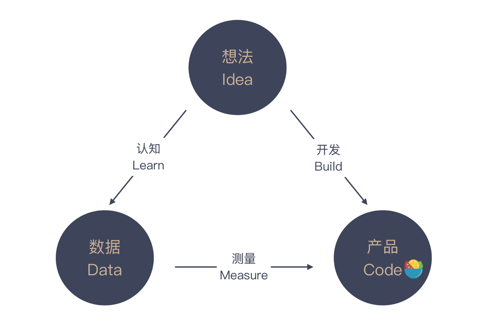
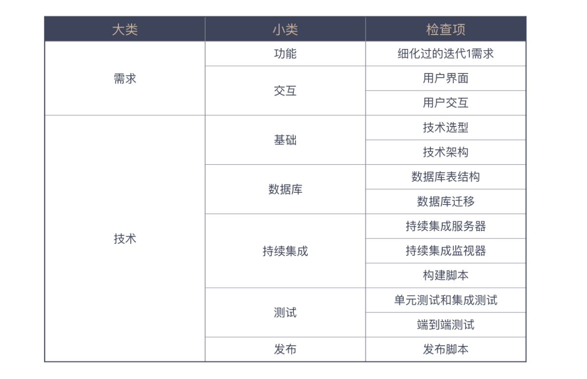
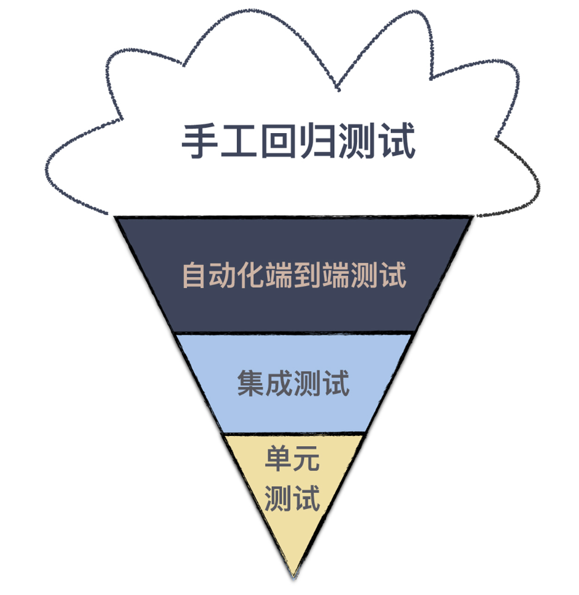
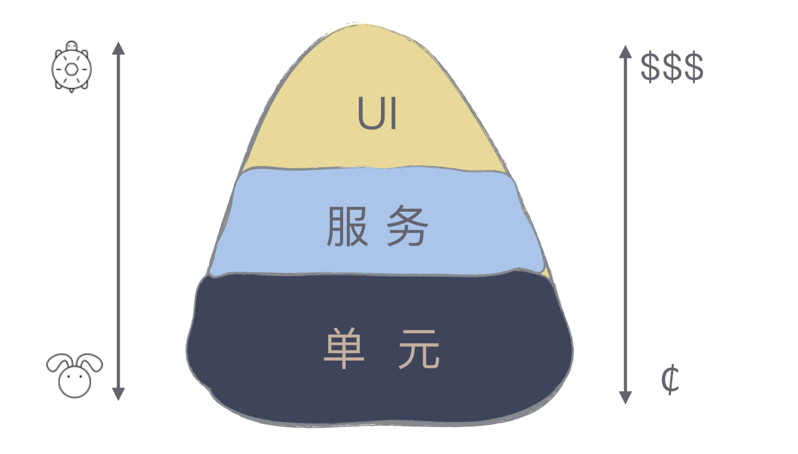
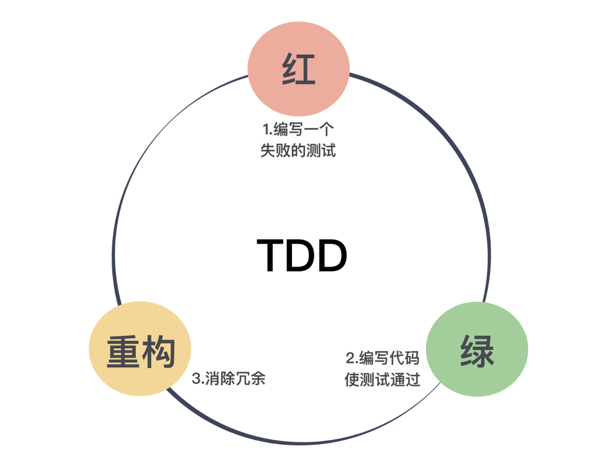
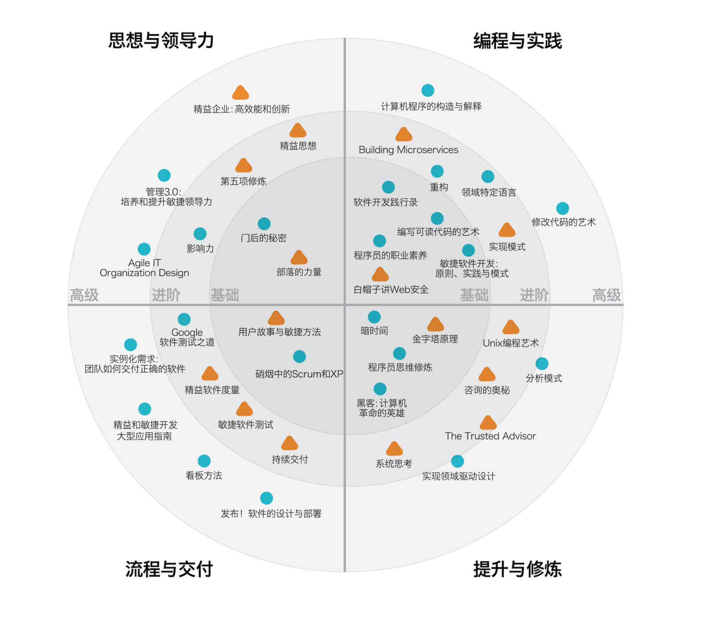
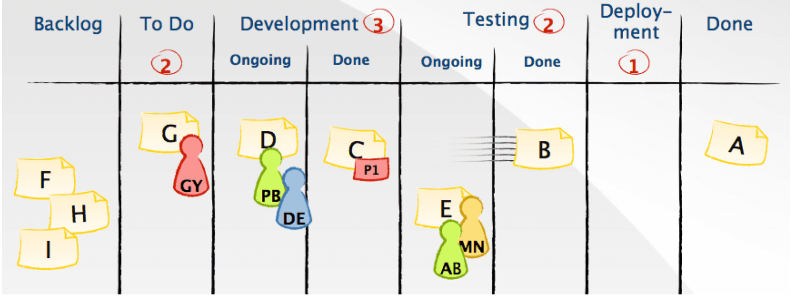
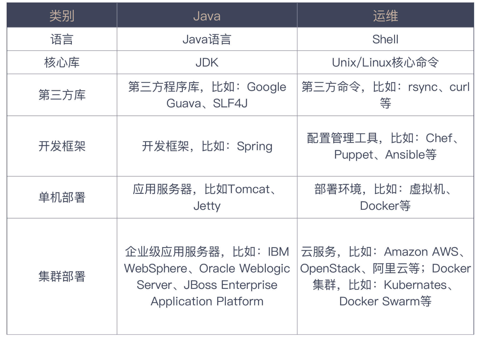

This post is my summary of what I learned from The Programmers' Work Method this month. It taught me how an excellent programmer should think and act when facing a project.

Below are my notes:

### 1. How should programmers think

- Four thinking principles
  - Why do we need to develop this feature? What value could it bring to users?
  - What kind of users will use this feature? In what scenarios will they use it? How will they use it?
  - Is there any other way to achieve that goal? Is it necessary to develop a system?
  - How will we measure whether the feature is effective after it launches?
- The framework for thinking:
  - Where are we?
  - Where are we going?
  - How can we get there?
- **Use this framework to ask yourself about your current situation, your goal and your path whenever you face a problem.**

## Begin with the end in mind

### 2. Begin with the end in mind: a counter-intuitive way of thinking

- **Practicing "begin with the end in mind" means considering the outcome before taking action, and deciding what to do based on that outcome.**

- **When you run into something, think it through backwards.**

### 3. The value of DoD (Definition of Done)

- Define the standard of "done" before you start anything.
- **DoD is a checklist made up of individual check items, used to verify how complete our work is.**
- **Each check item should be something that can actually be checked.**
- **DoD is a mechanism for team members to report status to each other.**

### 4. Describe the requirements

- User story
  - Title: briefly states what the user story is about, for example: a registered user logs in with a username and password.
  - Overview: briefly describes what the user story is about, usually in this format: As a (Role), I want to (Activity), so that (Business Value). That is: as a certain role, I want to do something so that I can achieve a certain outcome. The most important part is telling others why you are doing this. It is only one sentence, yet it is exactly the thinking most people skip: they know what to do but not why. An example: as a registered user, I want to log in with my username and password so that I can use the services available only to registered users.
  - Details: describes the full flow of the user story. We put things like the interaction flow and the user interface here. For example: if the user enters the correct username and password, the login succeeds; if the password is wrong, the login page shows "Incorrect username or password". Once programmers read this part, they can picture the user story in their minds. Out-of-scope items, such as third-party login, are also stated here, mainly to stop the scope from expanding.
  - Acceptance criteria: describes how the normal flow works and how the system responds in each abnormal flow — the kind of thinking programmers often skip. It turns much of the narrative in the details into concrete test cases. For example, here are two acceptance cases: Normal case: given a registered user Zhang San whose username is zhangsan and password is foobar, when Zhang San logs in with zhangsan and foobar, the login succeeds and he is redirected to the user center. Abnormal case: given the same registered user, when Zhang San logs in with zhangsan and wrong, the login fails and the login page shows "Incorrect username or password".

- **The most important part of acceptance criteria is the description of the abnormal flows.**

- **Acceptance criteria give the most basic test cases for this requirement, and they guarantee the minimum quality of the developers' implementation.**

- **Before starting any requirement or task, define the acceptance criteria first.**

### 5. Continuous Integration

- When we work in a team, the process of combining different people's code into a working piece of software is called integration.
  - **Commit code for integration as early as possible.** Continuous integration means integrating every time code is committed.

### 6. Lean Startup

- **Most people in the IT industry are not professional enough.**

- **We must think for ourselves, ask more "why"s, and cut down the number of times we fall into a pit and then ask for help.**

- **Software development has gradually shifted from solving deterministic problems to solving uncertain ones.**

- **Since the problem is uncertain, the only thing you can do is "try".**

- Build - Measure - Learn: a feedback loop

- **By default, say no to every requirement until you understand why it should be done.**

- Lean Startup introduces a very important concept: the Minimum Viable Product, or MVP — in short, spend less and get more done.

### 7. Expand your context

- **What really differs between roles at work is the context they have.**

- **The problem was often not solved by technical skill but bypassed by understanding the requirement.**

- **Expand the context of your work; don't limit yourself to the "programmer" role.**

### 8. Walk through it before you act

- **In most of our work, even when the goal is clear, the path is fuzzy.**

- **Before you start doing something, walk through it in your head first.**

### 9. Measure work with numbers

- If you design the metrics for measuring the effectiveness of your work from the start, you can work with more purpose.

- **Find problems in the numbers and make the system more stable.**

- **Ask yourself: can my work be measured with numbers?**

### 10. Preparing Iteration 0

- Iteration 0 is the iteration before Iteration 1, so we can think of it as the preparation phase of development.

- **Even if your project is not starting from scratch, checking it against this checklist will reveal what it lacks, and you can fill the gaps deliberately.**

- **Design your own Iteration 0 checklist and give your project a health check.**

## Task decomposition

### 11. Learning task decomposition from Elon Musk

- **Before you start a piece of work, break it down first.**

- **Provide an actionable breakdown.**

- **The difference between one "actionable" definition and another comes down to whether you clearly know how to solve the problem.**

- **The software industry today advocates embracing change, and task decomposition is the prerequisite for embracing it.**

### 12. Testing is also the programmer's job

- Testing should be everyone's job on a software team, not just the testers'.

- We should find and fix problems as early as possible — that is when the cost is lowest.

- If a problem can be solved at the requirement stage, don't leave it to development. Likewise, if it can be solved during development, don't leave it to testing.

- **For any programmer, only by writing both the code and the tests during development can you claim you delivered high-quality code.**

- Automated testing frameworks: **Bring automated testing into the development process as a best practice, so that testing becomes a standardized, repeatable routine.**

- Ice Cream Cone: an anti-pattern that costs time and effort

- Testing Pyramid: the industry's best practice

- Usually we run all unit tests and integration tests locally, and leave system tests to the CI server.

- Summary: **Write more unit tests.**

### 13. TFD vs TDD: Test-First Development vs Test-Driven Development

- Test-Driven Development

- **The difference between test-first development and test-driven development is refactoring.**

- After the feature is complete and the tests pass, we go back to the code to clean up anything poorly written, or any duplication between the new code and the existing code.

- **Because refactoring and testing work together, they drive you to write better and better code.**

- "Driven": **the code is driven by the tests.**

- **How should I write my code so that it can be tested? In other words, we need to write testable code.**

- **Before writing code, think about how you will test it.**

- **We should write testable code.**

### 14. The working secrets of master programmers

- **Kent Beck works in a clear, steady rhythm: after every task is finished, the code is in a committable state.**

- **Most programmers have low development efficiency because they often start coding before they have thought things through.**

- **Many people find TDD exercises easy to follow but don't know where to start when they try it themselves. What's missing in between is task decomposition.**

- **Once a task has been decomposed, the amount you need to hold in your head is limited, so you can focus on that task and think through the details clearly.**

- Task decomposition is the key to doing TDD well.

- **Break tasks down smaller — the smaller the better.**

### 15. A step-by-step walkthrough of task decomposition

- The order of the tasks on the task list follows the process of implementing one requirement end to end.

- **Many people prefer to write one class at a time. I would argue it is better to follow one requirement at a time, so that you can stop at any point.**

- Having broken the tasks down this far, check which of them will be hard to implement.

- **To tell whether a task has been broken down properly, ask yourself whether you know exactly how to do it.**

- Every decomposed task is independent. That is, **the code is committable after each task is finished.**

- **Order the decomposed tasks by the sequence of fully implementing a requirement.**

### 16. Write good tests

- **Only by breaking a complex test down into simple ones can you write tests well.**

- The basic structure of a test: setup, execution, assertion, and teardown.

- A good test is Automatic, Thorough, Repeatable, Independent, and Professional.

- **Write testable code.**

- **To write good tests, write simple tests.**

### 17. Managing requirements

- **Most problems come from decomposing too coarsely; rarely do they come from decomposing too finely.**

- There is an "INVEST principle" for evaluating user stories: **Independent, Negotiable, Valuable, Estimable, Small, and Testable.**

- **Estimates are relative, not absolutely precise. We don't need the rigor of scientific research — a relative estimate is enough.**

- Estimating user stories: **the process of estimating is also a process in which everyone deepens their understanding of the requirement.**

- Generally speaking, a user story should fit within one iteration.

- **To manage requirements well, break them down small first.**

### 18. Prioritizing requirements

- The Eisenhower Matrix (importance and urgency)

- **The time-management rule: do important and urgent things immediately. Important but not urgent things are where you should invest most of your effort. Urgent but unimportant things can be delegated. Do as little of the unimportant and non-urgent as possible.**

- **If you don't spend your energy on what's important, it will all turn into emergencies eventually.**

- **When an employee can't figure something out, putting themselves in the boss's shoes makes it clear at once.**

- **Do the most important thing whenever you can.**

### 19. Building a product at the lowest cost

- **What we are doing is verifying whether an idea is feasible — not even building software for its own sake; building software is just a means of verification.**

- **This team validated a whole bunch of ideas without writing a single line of code. Every bit of effort went into targeted validation.**

- But from a product-feasibility standpoint we need to shift our thinking: **it is not about how complete a single module is, but whether one user path works end to end.**

- **When time is limited, we need to learn to find a viable path and strike a balance between a complete user experience and a complete system.**

- Minimum Viable Product (MVP)

- **To apply MVP well in practice, you must find a viable path at the lowest cost.**

- Programmers like to solve problems with their own code, but writing code is usually a very expensive solution — it should be the last product solution you reach for.

- **The most practical way to build a product is to use MVP.**

## Communication and Feedback

### 20. Communication and feedback

- **Through communication and feedback, keep upgrading your encoding and decoding ability.**

### 21. Who are you writing your code for?

- **Write code in the language of the business.**

- Write maintainable code.

- **A simple test of whether a name is good enough: explain the code to someone and see how much extra explanation you have to add.**

- **People are the ones connecting business problems to machine execution; without business context you cannot write good code.**

- **It may only be a name change, but in terms of comprehension it is a huge leap: it shrinks the gap others have to cross to understand this code, and efficiency improves as a result.**

- Domain-Driven Design (DDD)

- **Write code in the language of the business.**

### 22. Lightweight communication

- **Meetings that work particularly well are almost always about information sync.**

- A meeting is a heavyweight form of communication.

- **So the first action item for better meetings is to cut the number of people in the discussion.**

- **The second action item is: if you need to discuss something, talk face to face.**

- Stand-up meeting:
  - What did I do yesterday?
  - What am I going to do today?
  - What problems did I hit, and where do I need help?

- **More face-to-face talk, fewer meetings.**

### 23. Visualization: a more intuitive way to communicate

- Technology Radar

- **Because the human brain is better at processing images.**

- Kanban

- A Kanban board makes the work visible in front of everyone.

- **Try to communicate visually more often.**

### 24. Continuous integration, fast feedback

- **Running the same operation locally is faster than on the CI server.**

- **Make good use of the local build script so that every kind of check can run locally.**

- Some teams distribute test runs: unit tests and integration tests run locally, while the heavier system tests run on the CI server.

- **In short, our goal is to get feedback fast.**

- Only commit code when the CI server is green;

- **Once the CI server reports a failure, fix it immediately.**

- Two kinds of feedback matter: instant feedback and conspicuous feedback.

- **The key to good continuous integration is fast feedback.**

### 25. Retrospectives

- **Seeing a problem from someone else's eyes is what we call objectification.**

- Retrospective meeting

- **First rule: write down facts, not feelings.**

- The team then tries to find a solution and comes up with action items. **Every action item must be checkable, not some claim that can't be verified.**

- The 5 Whys: keep asking why.

- **Hold retrospectives regularly, find the root cause, and keep improving.**

### 26. Listen to the voice of users

- **As a programmer without a user's perspective, you don't stand a chance in a conversation with a product manager, because one sentence beats you: "That's what users need."**

- **Move from listening to product managers to listening to users themselves.**

- "Eat your own dog food": **such improvements are subtle, and if you are not a user, it is very hard to see them through logic alone.**

- Deliberately create chances for the development team to get in front of users.

- Lean Startup and MVP exist precisely to get user feedback at the lowest cost.

- Make business language the shared language of communication.

- **Whoever is closest to the user has a voice — whatever your role.**

- **Get closer to users.**

### 27. Surface problems as early as possible

- **Not every problem is a technical challenge worth solving.**

- **When you hit a problem, the best move is to surface it as early as possible.**

- Fail Fast.

- Overcoming the mental barrier and admitting your own problems at work is a real challenge.

- The earlier you move, the more room and slack you leave for others, and the more chances there are to adjust. The cost of a problem that appears at the last minute is far too high to bear.

- If you can't get it done in the time available, tell others as early as possible.

- **Move things forward early, and surface problems as soon as they appear.**

### 28. Writing docs is also a way to learn

- **The real reason many people avoid writing docs is that what they know can't be structured well.**

- **There are many ways to structure scattered knowledge, and writing it out is the key step.**

- **The act of writing is essentially the act of connecting knowledge.**

- The Pyramid Principle gives a model that goes from the central argument to sub-arguments to evidence, which helps us organize knowledge.

- To get good at producing knowledge, you need constant practice; both writing and public speaking can be improved through practice.

- **Produce more output, so your knowledge becomes better structured.**

## Automation

### 29. Learn to be lazy: automation

- **Don't automate**: **doing valuable work matters, and "value" here is not only what you "do" — the time and cost saved by "not doing" is valuable too.**

- NIH Syndrome (Not Invented Here): someone dismisses what others built and insists on making their own version, simply because it wasn't invented here, perhaps imagining all sorts of problems with it.

- Doing automation well

- Understand software design: **in software development everything else is changeable, but the variability of design is the one thing you can control.**

- Ask yourself whether our own work process is well automated while we build automation tools for others.

- To build good automation tools, you need a thorough understanding of software design.

- **Automate your work with care.**

### 30. What a well-automated job looks like

- Take Java Spring Boot + Gradle as an example.

- **Automate your work process.**

### 31. Ops knowledge

- Knowledge system

- **Learn operations knowledge systematically and incrementally.**

### 32. Continuous Delivery

- The ability to keep software ready to deploy to production at any time.

- Validate the release package and the deployment.

- Validating the release package means not only functional checks but also checks in combination with the environment.

- DevOps

- DevOps covers many areas; the most direct impact on programmers is the growth of tooling, which is pushing forward another idea: Infrastructure as Code (IaC).

- **Take deployment into account during development.**

### 33. Automated acceptance testing

- Acceptance testing verifies whether an application meets its specifications.

- **If you want to do BDD (Behavior-Driven Development), describe it in business language.**

- The basic format of "Given... When... Then"

- Best practice for writing BDD test cases: describe test cases from a business perspective.

- **Automate acceptance testing.**

### 34. Design principles

- SOLID principles
  - Single Responsibility Principle (SRP)
  - Open-Closed Principle (OCP)
  - Liskov Substitution Principle (LSP)
  - Interface Segregation Principle (ISP)
  - Dependency Inversion Principle (DIP)

- The Single Responsibility Principle, explained:
  - A module should be responsible to only one kind of actor.
  - **How many actors you can see a module serving depends entirely on your decomposition ability.**
  - The Single Responsibility Principle applies at different levels. When writing a class, ask whether its methods serve one kind of actor; when writing a method, ask whether its code is at one level of abstraction; even for a service, ask from a business standpoint whether it provides one kind of service.

- **Keep functions short.**

### 35. Layering

- **Layered architecture is, in essence, decomposition in design.**

- The real value of layering: **building a good abstraction.**

- Layered abstraction is everywhere in computing — from programming languages to network protocols, all showing the value of layered abstraction.

- In our daily work, we should put our energy into building our own domain model, because it is the core, least changeable part of the work.

- Domain-Driven Design

- **Build your domain model well.**

### 36. Why do some people think 50,000 yuan is enough to build a Taobao?

- **Because as programmers we need to know what kind of system we are actually dealing with.**

- The key point: **different volumes of traffic.**

- **Systems of different orders of magnitude are simply not the same system.**

- **The real force driving Taobao's engineers to improve their system is not technology, but the growing complexity of problems caused by ever-rising traffic.**

- Don't apply technology blindly and add unnecessary complexity to the system.

- **Solve problems with simple technology until the problem becomes complex.**

### 37. Get DDD right before talking about microservices — that's just a deployment form

- **Microservices are a backend software architecture style. The core idea is to split one large application into many small, independent services, each owning one clear business function and able to be developed, deployed, run, and scaled independently.**

- **How to split microservices is really a question of how to decompose a large system.**

- The core idea of DDD: **don't design the system starting from database tables, code classes, or technical frameworks; start by understanding the system from the business domain.**

- A bounded context can become an independent deployment unit, and an independent deployment unit can become a microservice.

- First keep everything modular within a single project and let the services evolve for a while; when a module is genuinely ready to "graduate", then start the microservices journey.

- Learn Domain-Driven Design.